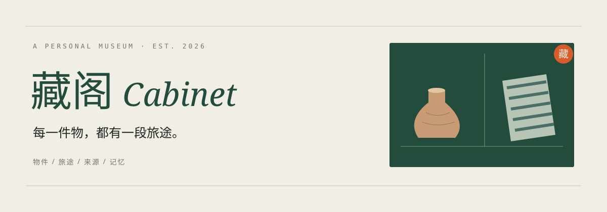

<p align="center">选择语言 / Language: <strong>简体中文</strong> · <a href="README.md">English</a></p>

<p align="center">
  
</p>

<p align="center">
  <strong>一座记录物件、旅途、来源与记忆的私人博物馆。</strong><br>
  将带回家的小物件，连同当时的故事，一起收入藏阁。
</p>

## 每一件物，都有一段旅途

一块旅行中买到的织物，一只旧陶器，一件舍不得丢的小物。藏阁帮你把它们的照片、来处与故事收在一起，在自己的电脑上慢慢建立一座私人博物馆。

## 功能

- **整理收藏**：用照片浏览藏品，按名称、故事、地点搜索，按类别筛选。
- **留住故事**：记录来源、材料、工艺、购入价格和自己的记忆。
- **重访旅迹**：沿时间轴回看收藏，或在世界地图上探索它们的来处。
- **容纳不确定**：日期可以只记到年或月，也可以暂时留空；区分事实、口述与推测。
- **保存在本地**：上传自己的照片，无需注册账号或订阅服务。

## 快速开始

需要 **Python 3.11 或更新版本**。

```bash
git clone https://github.com/hhaolinh/museum.git
cd museum
python3 -m venv .venv
source .venv/bin/activate
pip install -r requirements.txt
flask --app app run
```

打开 [http://127.0.0.1:5000](http://127.0.0.1:5000)，记录第一件藏品。

Windows 用户将激活命令替换为 `.venv\Scripts\activate`。当前版本供本机个人使用，应用界面为中文。

## 文档

- [使用与备份](docs/guide.zh-CN.md)
- [开发说明](docs/development.md)
- [数据来源与许可](data/SOURCES.md)

---

<p align="center"><sub>物会记住我们遗忘的事。</sub></p>
